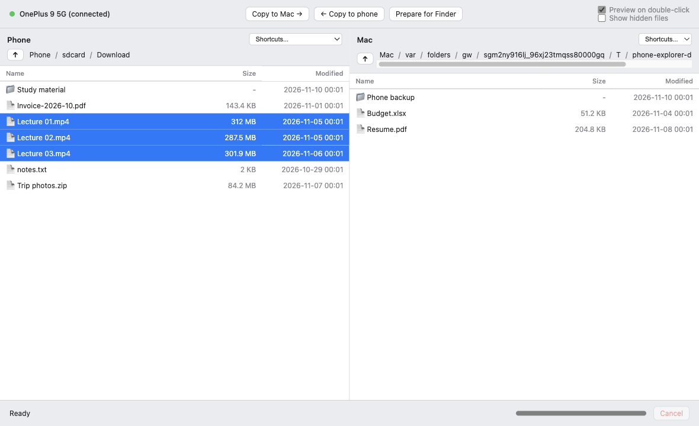
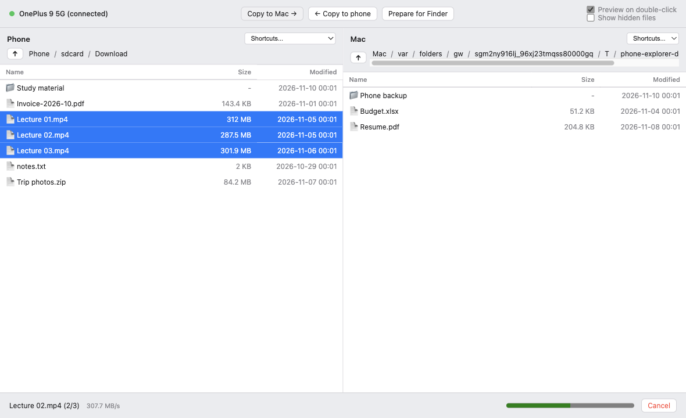

# Phone Explorer for Mac

Browse your Android phone from your Mac in a two-pane file explorer, and drag files and folders between them.

macOS can't open Android phones on its own. Phone Explorer talks to the phone over USB with Google's `adb` tool,
so there's no MTP flakiness and no fight with macOS's Image Capture service. Why it exists: [docs/background.md](docs/background.md).



## Features

- **Two panes:** phone on the left, any Mac folder on the right.
- **Select like Finder:** click, Shift-click, Cmd-click, Cmd-A; Enter opens, Esc clears.
- **Drag and drop both ways:** phone ↔ Mac pane, Finder → phone, phone → Finder.
- **Folders too:** whole folders copy with their structure.
- **Progress and Cancel** for every copy, with speed.
- **Double-click to preview:** a phone file is copied to a temporary folder and opened, and the copy is deleted later.
- **Copy only:** never deletes, renames or overwrites. A name clash saves as `name (1)`.
- **Safe previews:** only photos, videos, music and documents open; anything else is shown in Finder, never run.

## Install

1. Download the latest **`.dmg`** from [Releases](https://github.com/muditagarwal88/phone-explorer-mac/releases/latest).
2. Open it and drag **Phone Explorer** onto **Applications**.
3. First launch: macOS warns that the developer can't be verified (the app isn't notarized).
   Open **System Settings ▸ Privacy & Security** and click **Open Anyway**.
4. Install Google's `adb` tool, which the app uses to talk to the phone:

   ```bash
   brew install --cask android-platform-tools
   ```

Requires macOS on Apple Silicon (M1 or later).

## Phone setup (once)

1. Settings ▸ About phone ▸ tap **Build number** 7 times to unlock Developer options.
2. Settings ▸ System (or Additional settings) ▸ Developer options ▸ turn on **USB debugging**.
3. Plug the phone into the Mac and tap **Allow** on the "Allow USB debugging?" prompt.

The phone appears in the top-left within a couple of seconds. Not showing up? See [troubleshooting](docs/troubleshooting.md).

## Using it

| To do this | Do this |
|---|---|
| Copy phone → Mac | Drag onto the Mac pane, or select and press **Copy to Mac →** |
| Copy Mac → phone | Drag onto the phone pane (from the Mac pane or Finder), or press **← Copy to phone** |
| Copy phone → Finder | Select, click **Prepare for Finder**, wait for **Ready**, then drag to Finder |
| Preview a phone file | Double-click it. Turn off with **Preview on double-click** |
| Open a folder | Double-click it, or use the path bar and **Shortcuts** menu |



## Build from source

Needs Node 22+ and macOS.

```bash
npm install
npm start
```

| Command | Does |
|---|---|
| `npm test` | Unit tests against a fake adb (no phone needed) |
| `npm run test:ui` | Playwright tests that drive the real app window |
| `npm run package` | Builds `dist/Phone Explorer.app` |
| `npm run dist` | Builds `dist/Phone-Explorer-<version>-arm64.dmg` |
| `npm run screenshots` | Regenerates the README screenshots from made-up files |

You can also double-click `scripts/Run from source.command` in Finder.

## Project layout

```
main.js             Electron main process: window, IPC, adb and copy jobs
preload.js          The small, safe API the window is allowed to use
src/                adb wrapper, phone and Mac listing, copy engine, Finder drag cache, previews
renderer/           The two-pane UI (plain HTML, CSS, JS)
test/               Unit tests, a fake adb that emulates a phone, Playwright UI tests
scripts/            Build the app and DMG, screenshots, run-from-source launcher
docs/               Background, troubleshooting, original design notes
```

## How it works

- **Listing:** `adb shell ls -lA '<folder>/'` for the phone, Node's `fs` for the Mac.
- **Copying:** `adb pull` / `adb push`, one file at a time, so progress and Cancel are exact. A cancelled copy removes only its own partial file.
- **Phone → Finder:** Electron can't promise files to Finder, so the app copies them to a cache first, then hands macOS a real file drag.
- **Safety:** adb is always run with an argument list, never a shell string, and phone paths are quoted.

## Credits

Built with [Claude Code](https://claude.com/claude-code). See [docs/background.md](docs/background.md) for the story.

## License

[MIT](LICENSE)
